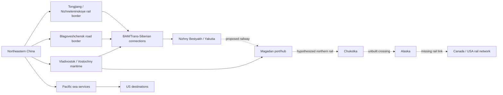

# Network topology and realistic alternatives

## Existing and conceptual structure

Diagram shows **functional alternatives, not a surveyed civil engineering alignment**. Routing China→Magadan via all cities sequentially would be an artificial detour; the network must choose the lowest full-cost OD route.

## Four capital decisions

**A. Magadan standalone**: warehouses, terminal handling, reefer plugs, port access, road last mile, reserves, independent cargo owners. **B. Yakutia→Magadan**: new railway and bridge/permafrost works. **C. Magadan→Chukotka**: independent frontier rail concept. **D. Subsea crossing / Alaska / Canada**: largest regulatory, engineering and network-gap dependencies.

## Competing routes

- Sea: Shanghai/China → US West Coast → inland USA; verify expedited Matson service rather than assuming 40-day baseline.
- Sea: Vladivostok → Magadan with SASCO/KMP/FESCO. Rate, shipping conditions, VAT and sailing times are separate attributes.
- Rail: Northeast China via Tongjiang–Nizhneleninskoye onto Russian network with capacity, customs and rail gauge limitations.
- Road: China via Blagoveshchensk with road/terminal transshipment; not a direct rail border.
- Existing Alaska rail: internal network only; Nome and cross-border Canada link require entirely new infrastructure.

All proposed alignments require rigorous GIS, hydrology, permafrost, seismic, environmental and Indigenous consultation studies.
